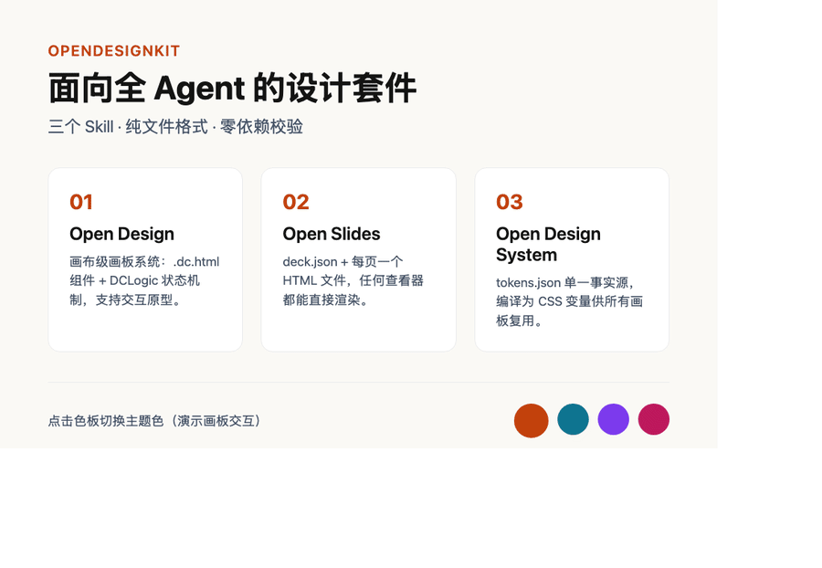

[中文](README.md) | **English**

# OpenDesignKit

> 面向全 Agent 的工业级设计套件 —— 把 Claude Design / Claude Slides / Claude Design System 三大 Skill 从专有宿主中解耦，让任意 Agent 工具（Claude Code、Antigravity CLI、Cursor、Cline……）都能生成顶级设计稿与演示文稿。

**作者**：[TaylorChen（AI即世界）](https://github.com/TaylorChen) · AI Agent 工程师

**在线体验**：[文档站](https://taylorchen.github.io/OpenDesignKit/) · [示例画廊](https://taylorchen.github.io/OpenDesignKit/gallery.html)（浏览器直接打开放映器/交互画板）

源自 [JimLiu/baocut](https://github.com/JimLiu/baocut) commit [`7aa049e8`](https://github.com/JimLiu/baocut/commit/7aa049e8) 中的内置 Skill，经通用化改造：**移除宿主专有依赖，改为纯文件格式 + 可选工具适配**，任何能读写本地文件的 Agent 都可以使用。

## 三个 Skill

| Skill | 产物格式 | 用途 |
|---|---|---|
| [`open-design`](skills/open-design/SKILL.md) | `canvas.json` + 每块画板一个 `.dc.html` | 界面 / 网页 / 海报 / 信息图 / 原型等视觉设计稿，支持交互组件（DCLogic 状态机制） |
| [`open-slides`](skills/open-slides/SKILL.md) | `deck.json` + 每页一个 HTML 文件 | 幻灯片 / 演示文稿 / 讲稿页，任何现代浏览器可直接渲染 |
| [`open-design-system`](skills/open-design-system/SKILL.md) | `design-system.json` + `tokens.json` + `README.md` + components/assets/fonts | 品牌设计系统：颜色、字体、间距 tokens 与品牌手册 |

三者的关系：设计系统提供 **tokens 单一事实源** → 设计稿画板与幻灯片**引用** tokens → 产物全部是**纯本地文件**，无需数据库或远程服务。

## 目录结构

```
OpenDesignKit/
├── skills/
│   ├── open-design/           # 设计稿 Skill（SKILL.md + references/ 9 篇）
│   ├── open-design-system/    # 设计系统 Skill（SKILL.md + references/ 6 篇）
│   └── open-slides/           # 幻灯片 Skill（SKILL.md + references/ 4 篇）
├── tools/
│   └── validator.py             # 零依赖校验器（纯 Python 3 标准库）
├── examples/
│   ├── demo-design/             # 设计稿示例（canvas.json + Main.dc.html）
│   ├── demo-design-system/      # 设计系统示例（tokens + 品牌手册）
│   └── demo-slides/             # 幻灯片示例（deck.json + 3 页）
├── LICENSE
└── README.md
```

## 安装到你的 Agent 工具

Skill 本质是「一份指令文档 + 参考页」，把它放进宿主的 skills 目录即可：

| 宿主 | 安装方式 |
|---|---|
| **Claude Code** | `cp -r skills/* ~/.claude/skills/`（或项目内 `.claude/skills/`） |
| **Antigravity / agy CLI** | `cp -r skills/* ~/.gemini/skills/` |
| **Cursor / Cline / 其它** | 把 `SKILL.md` 内容放进系统提示词或 rules，references/ 按相对路径随项目携带 |
| **任意 Agent** | 在提示词中写明："做设计稿时阅读 `skills/open-design/SKILL.md` 并遵循" |

无版权与依赖门槛：SKILL.md 与 references/ 全部是 Markdown，产物全部是 HTML/JSON。

## 安装

```bash
git clone https://github.com/TaylorChen/OpenDesignKit.git
cd OpenDesignKit
pipx install .                        # 或 pip install .；之后全局可用 odk
odk --version
```

也可以完全不安装：克隆后直接 `python3 tools/validator.py ...`（同一引擎，零依赖）。

> PyPI 发布规划中；当前请从源码安装。

## 校验与工具链（推荐的工作流闭环）

每个 Skill 的工作流都是「写文件 → 校验到零错误 → 交付」。随附的零依赖 CLI `odk`（纯 Python 3 标准库）：

```bash
# 校验（自动识别 deck / canvas / design-system）
odk check examples/demo-slides
odk check examples/demo-design --json      # 机器可读输出（供 agent / CI）

# 脚手架：生成开箱即过校验的骨架
odk init deck my-deck                      # deck.json + 封面页 + 播放器
odk init canvas my-canvas                  # canvas.json + 画板 + support.js
odk init system my-brand                   # tokens + 品牌手册 + tokens.css

# 构建
odk build player my-deck                   # 重新生成含最新讲稿的放映器
odk build tokens my-brand                  # tokens.json -> tokens.css

# 预览与导出
odk serve my-canvas                        # 本地预览服务（启用 dc-import 子组件）
odk export-pdf my-deck                     # 每页导出 16:9 PDF（需本机 Chrome）
```

播放器：双击生成的 `player.html` 即可放映——←→ 翻页、`S` 讲稿、`O` 目录、`F` 全屏；支持 `?n=2`、`?notes=1` 参数。三个示例当前均为 **0 错误 0 警告**。校验器检查：JSON 结构与版本、order/board 完整性、画板必备元素（`<x-dc>`、DCLogic 脚本、`data-props`）、禁用标签、`$preview` 与画框一致性、1920×1080 舞台、token 命名/取值合法性等。

## 预览

**幻灯片放映器**（`build-player` 生成，双击即用：← → 翻页 · S 讲稿 · O 目录 · F 全屏）：


**可交互画板**（`support.js` 预览运行时在普通浏览器中渲染；点击右下角色板实时切换全板主题色）：



| 幻灯片（浏览器直接打开） | 播放器 + 讲稿面板 |
|---|---|
|  |  |

## 快速体验示例

- `examples/demo-slides/`：浏览器打开任意 `slides/*.html` 即可全屏查看；
- `examples/demo-design/`：**双击 `Main.dc.html` 即可在浏览器预览可交互画板**——仓库自带独立实现的轻量预览运行时 `support.js`（{{ 插值 }}、sc-for/sc-if、onClick 事件、DCLogic 状态）：点击右下角色板可实时切换主题色；
- `examples/demo-design-system/`：`README.md` 即品牌手册，`tokens.json` 是机器可读的 token 源。

> 给自己生成的画板加预览：把 `examples/demo-design/support.js` 复制到画板同级目录即可（`<script src="./support.js">` 已是格式标准钩子）。兼容编辑器存在时优先用编辑器自身的运行时。

## 设计原则

1. **文件即产物**：不依赖任何专有运行时；编辑器/查看器只是"按磁盘原样读取文件"的宿主。
2. **宿主能力优雅降级**：若宿主提供 `design_import_asset` / `slides_import_asset` 等工具则用之；否则退化为相对路径引用与手动校验。
3. **验证优先**：所有产出先过 validator，再交给用户。

## 致谢与来源

- 上游：[JimLiu/baocut](https://github.com/JimLiu/baocut) —— commit `7aa049e8` 引入 Claude Design（Design Canvas + Design System）与 Claude Slides 集成。`skills/` 目录为该提交对应内置 Skill 的**修改版**（通用化改造），非官方发布物。
- 背景：[@dotey 的推文讨论](https://x.com/dotey/status/2109482425722057154)
- 本仓库与 Anthropic 无隶属或背书关系。

## License

- `tools/`、`examples/`、文档：**MIT**（[LICENSE](LICENSE)）
- `skills/`（改编自上游）：**BaoCut Community License v1.0**（[licenses/baocut-community-license.txt](licenses/baocut-community-license.txt)），允许非商业免费共享与修改，商业化需上游书面授权；详见 [NOTICE.md](NOTICE.md)
